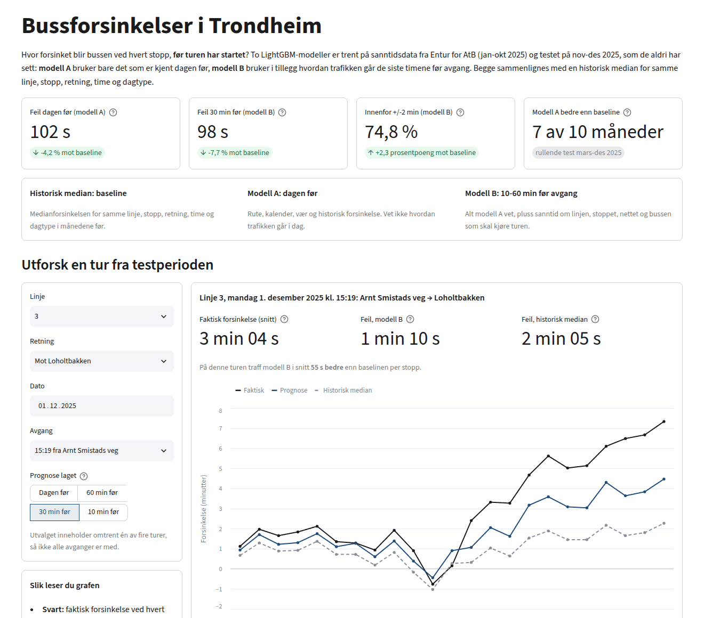

# Bussforsinkelser i Trondheim, prediksjon før avgang

[](https://github.com/jeghetermats/bussforsinkelser-trondheim/actions/workflows/ci.yml)

Hvor forsinket blir bussen ved hvert stopp, før turen har startet? Prosjektet bruker rundt 43 millioner
sanntidsmålinger fra Entur for AtB (desember 2024 til desember 2025) og sammenligner to LightGBM-modeller
med en historisk median.

**Resultat:** Med sanntidsdata 30 minutter før avgang bommer modellen 7,3 % mindre enn den historiske
medianen, målt på to måneder den aldri har sett (95 % KI: 6,6-8,1 %).

Python · Google BigQuery · DuckDB · LightGBM · Streamlit · pytest · GitHub Actions

## Demo

Prøv appen: [bussforsinkelser-trondheim.streamlit.app](https://bussforsinkelser-trondheim.streamlit.app/)

Utforsk enkeltturer fra testperioden og se hvordan modellene står seg mot baselinen.

[](https://bussforsinkelser-trondheim.streamlit.app/)

## Resultater

Test: november-desember 2025 (1,7 mill. målinger, 61 dager), ikke brukt i trening eller modellvalg.
MAE er hvor mange sekunder prognosen bommer med i snitt.

| Modell | Når prognosen lages | MAE | Forbedring mot baseline (95 % KI) |
|---|---|---|---|
| Historisk median (baseline) | | 106,5 s | |
| Modell A | Dagen før | 102,3 s | 4,0 % [3,0-4,8] |
| Modell B | 30 min før avgang, med sanntidsdata | 98,7 s | 7,3 % [6,6-8,1] |

- **Sanntidsdata gir mest.** Modell B bommer 3,5 % mindre enn A. En kontrollmodell trent på samme måte, men
  uten sanntidsdata, havner på nivå med A, så gevinsten kommer fra sanntidsdataene.
- **Det viktigste signalet er hvordan dagen går** på samme linje de siste timene. Prognosen er nesten like god
  60 som 10 minutter før avgang.
- **Gevinsten holder mot en strengere baseline.** Forsinkelsene steg gjennom høsten, så en median fra bare de
  siste 8 ukene bommer 1,8 % mindre enn den vanlige. Mot den er A 2,3 % og B 5,7 % bedre (30 min før avgang).
- **Mye er tilfeldig før avgang.** Et 80 %-intervall rundt prognosen er typisk rundt 4,5 minutter bredt.

## Hvordan det fungerer

1. **Data:** SIRI-ET-data fra Entur hentes måned for måned fra BigQuery, og timesvær fra Open-Meteo.
2. **Features i DuckDB:** linje, stopp, retning, rutetid, kalender (helligdager, skoleferie), dagslys, vær og
   historisk forsinkelse per linje, stopp og time, beregnet over alle 43 millioner rader.
3. **Modell A** (dagen før) bruker bare det som er kjent dagen i forveien.
4. **Modell B** (10-60 min før avgang) får i tillegg sanntidsdata fra samme dag: avvik på samme linje og stopp
   de siste timene, forrige buss ved stoppet og bussen som skal kjøre turen.
5. **Appen** viser prognosene for testperioden og bruker bare forhåndsberegnede filer.

## Hvordan resultatene er testet

- **Tidsbasert splitt:** trening januar-august 2025, validering september-oktober, test november-desember.
  Alle valg er tatt på validering, testen er bare brukt til endelig evaluering.
- **Ingen datalekkasje:** historiske features ser aldri sin egen fasit, antall stopp på turen tas fra tidligere
  dager, og modell B får bare data registrert minst 2 minutter før prognosen lages. Forsinkelsen ved forrige stopp er
  bevisst utelatt, siden den nesten gir svaret. Dette sjekkes av tester som kjører pipelinen på oppdiktede data.
- **Konfidensintervaller** med bootstrap over testdagene, i stedet for ett enkelt tall.
- **Kontrollmodell og enkel regel** for å vise at det er sanntidsdataene, ikke modellen alene, som gir gevinsten.
- **Rullende evaluering:** modell A trent bare på tidligere måneder og testet måned for måned (mars-desember).
  Den slår baselinen i 7 av 10 måneder, i snitt med 0,7 %. Retrent også med måneden brukt til early stopping,
  slik hovedmodellen er, slår den baselinen i 10 av 10 måneder, i snitt med 2,9 %.
- **Ablasjon:** endringer i oppsettet testet én om gangen for å finne ut hva som faktisk hjalp.

Detaljer om oppsett, alle features, ablasjonen, usikkerhet, kontroller av evalueringen og det som ikke virket finnes
i [docs/experiments.md](docs/experiments.md).

## Begrensninger

- Før avgang er mye av forsinkelsen tilfeldig, så forbedringen over en god historisk median er moderat.
- Værdata er målt vær, ikke værvarsel (`src/weather.py --forecast` henter varselet fra dagen før i stedet).
- Modell B bruker de endelige registrerte tidene. Den ekte sanntidsstrømmen kan komme senere eller bli rettet
  i ettertid, og bufferen på 2 minutter dekker bare en del av det.
- Datasettet mangler kjøretøy-id, så bussen som skal kjøre turen finnes bare for rundt 10 % av turene.
- Antall stopp på turen er det vanlige for samme planlagte tur de siste 4 ukene, ikke stoppene som ble registrert:
  6,5 % av turene mangler de siste stoppene og er mer forsinket enn andre turer, så det registrerte antallet ville
  røpet litt om det som skjer etter avgang. Med det så modellene litt bedre ut enn de er (A 4,3 % og B 7,8 % bedre
  enn baselinen, mot 4,0 % og 7,3 % nå; se [docs/experiments.md](docs/experiments.md#kontroller-av-evalueringen)).
  Etter en ruteendring kan det planlagte antallet henge etter i et par uker.

## Kjør prosjektet

Se appen (trenger verken data eller modeller):

```bash
pip install -r app/requirements.txt
streamlit run app/streamlit_app.py
```

Tester (kjøres også automatisk med GitHub Actions ved hver push, sammen med `ruff`):

```bash
pip install -r app/requirements.txt duckdb==1.5.5 pytest==9.1.1 ruff==0.16.9
ruff check .
pytest
```

Lekkasjetestene (`tests/test_history.py`, `tests/test_pipeline_leakage.py`) kjører `features.py` og
`realtime.py` på små, oppdiktede data i en midlertidig mappe (`DATA_DIR`). De endrer fasiten i data en rad ikke
skal kunne se (radens egen dag, framtiden, alt etter prognosetidspunktet), eller fjerner stopp fra turer som blir
avkortet etter prognosetidspunktet, og sjekker at radens features er de samme.
`tests/test_readme_numbers.py` sjekker at tallene i README og `docs/experiments.md` stemmer med `reports/`.

<details>
<summary>Hent data, tren og evaluer</summary>

Alt etter at rådata og vær er hentet, i riktig rekkefølge og med tester før og etter: `python run_all.py`
(`--list` viser stegene, `--from <steg>` fortsetter etter en feil, `--checks` tar med kontrollene av evalueringen).

```bash
pip install -r requirements.txt
gcloud auth application-default login
export GCP_PROJECT=<ditt-prosjekt>   # Google Cloud-prosjektet som betaler for BigQuery (Windows: set)
python retrieval.py 2024 2025     # data fra BigQuery, måned for måned -> data/raw/ (finnes fra des 2024)
python src/weather.py             # timesvær fra Open-Meteo
python src/features.py            # DuckDB: rensing, historikk over alle rader, train/valid/test

python src/train.py               # modell A + test nov-des (+ bootstrap-KI)
python src/importance.py          # permutasjonsviktighet for modell A (vises i appen)
python src/rolling_eval.py        # rullende evaluering mars-des
python src/ensemble.py            # modell A: seed-snitt og blanding med baselinen, vekt valgt på sep-okt
python src/realtime.py            # modell B: sanntidsfeatures -> data/rt_*.parquet
python src/select_rt.py           # modell B: valg av variant på sep-okt
python src/train_rt.py --r1       # modell B runde 1 (til sammenligningen runde 2 mot runde 1)
python src/train_rt.py            # modell B: 3 seeds + test per lead (--no-rt = kontroll uten sanntid)
python src/finalize.py            # endelige tall (reports/final.json) og A-prognosene til appen
python src/oracle.py              # orakel-analyse (etter finalize)
python src/rt_breakdown.py        # B mot A per lead og posisjon på ruten
python src/evaluate_extra.py      # > 3 min (AUC/Brier), 80 %-intervaller, verste dager
python src/ablation.py            # ablasjon (valgfritt, flere timer)
python src/ablation.py --cv --seeds 0,1   # valg av oppsett over mars-okt (valgfritt)
python src/check_trip_structure.py        # avslører turstrukturen noe om forsinkelsen? (valgfritt)
python src/rolling_eval.py --refit --min-rounds 100   # rullende evaluering som hovedmodellen (valgfritt)
```

</details>

## Datakilder

Entur, [data.entur.no](https://data.entur.no) (NLOD) og [Open-Meteo](https://open-meteo.com).
